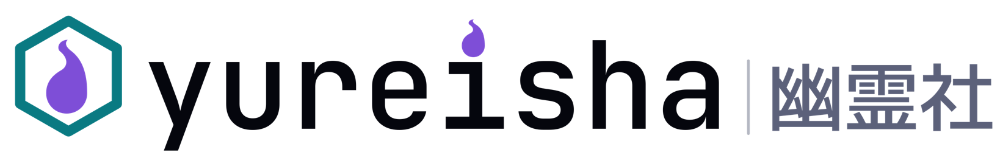

  <picture>
    <source media="(prefers-color-scheme: dark)" srcset="https://raw.githubusercontent.com/yureisha-io/.github/main/assets/lockup-dark.png">
    
  </picture>

<strong>Many shells. One ghost.</strong>

**Yureisha** (幽霊社, *ghost company*, Japanese for a shell company) is a native macOS app, in development and not
yet released, that runs a small company of
coding agents for each of your projects: departments and roles as data, dispatch, continuation, a decisions inbox and
experiments. You stay the operator; Yureisha brings you only the decisions that need you.

- **Availability:** not released yet. A Mac App Store build and a direct download (to be Developer ID signed and
  notarized by Apple) are planned; nothing has been published.
- **Will require:** a Mac with Apple silicon. Yureisha is built for arm64 only.
- **Website:** yureisha.io (not live yet)
- **Releases and release notes:** [yureisha-io/releases](https://github.com/yureisha-io/releases) (empty until the
  first release)

Yureisha is made by Black Mesa Lab.
